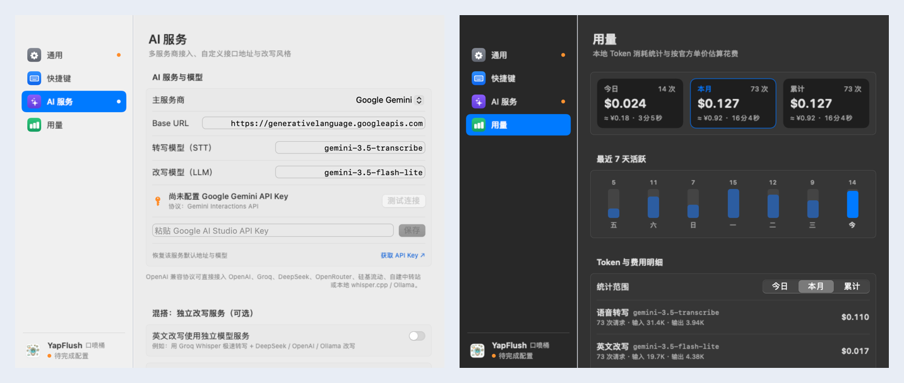

<p align="center">
  
</p>

<h1 align="center">YapFlush（口喷桶）</h1>

<p align="center">
  <strong>Hold a key, yap into the pixel toilet, flush out clean text.</strong><br/>
  A playful, privacy-first macOS menu bar voice-to-text tool with multi-provider AI support.
</p>

<p align="center">
  <a href="README_zh.md">中文文档</a> ·
  <a href="#features">Features</a> ·
  <a href="#supported-ai-providers">AI Providers</a> ·
  <a href="#build-from-source">Build from Source</a>
</p>

<p align="center">
  
</p>

---

## Why YapFlush?

Typing polished posts, messages, or prompts takes effort—especially when you're thinking fast in one language and writing in another. **YapFlush** sits quietly in your macOS menu bar:

1. **Hold a hotkey** (`Left Option` for rewritten English, `Left Control` for direct transcript—both customizable).
2. **Yap freely.** A retro pixel-art toilet pops open in the corner; icons arc into the bowl and splash in real time to your voice.
3. **Release.** The lid slams shut, your speech is transcribed & optionally rewritten, and clean text is pasted straight into your cursor—without cluttering your clipboard history.

---

## Features

- **Playful Pixel-Art Recording HUD**: Custom color-decontaminated sprite matting (crisp on both light and dark wallpapers), parabolic particle arcs, damped-spring squash & stretch, bowl-lip occlusion clipping, and a minimal live audio equalizer pill.
- **Multi-Provider AI Support (Bring Your Own API)**:
  - Works out of the box with **Google Gemini**, **OpenAI**, **Groq**, or **any OpenAI-compatible endpoint** (DeepSeek, OpenRouter, SiliconFlow, custom relays, or local `whisper.cpp` / `mlx-whisper` / `Ollama`).
  - **Mix & Match**: Optionally run Speech-to-Text on one provider (e.g. Groq Whisper) and LLM Rewriting on another (e.g. DeepSeek / OpenAI / Ollama).
- **Native macOS Settings & Usage Tracking**:
  - Clean macOS System Settings sidebar layout (Light & Dark mode).
  - Local numeric-only **Token & Cost Estimator** (Today / Month / All-Time + 7-day activity bars)—zero audio or text is ever written to disk.
- **Thoughtful Dictation Craft**:
  - Automatic silence detection & leading/trailing silence trimming.
  - Transient pasteboard markers (`org.nspasteboard.TransientType`) + automatic clipboard restoration so clipboard managers (Raycast, Paste, Maccy) stay clean.
  - Automatic retry on transient `503`/`504`/timeout errors, plus in-memory retry for failed recordings and last-5 history.
  - API keys are stored strictly in **macOS Keychain**.

<p align="center">
  
</p>

## Make the English sound like you

1. **Try the original first.** Give Gemini or your preferred writing agent the [default rewrite prompt](YapFlush/Resources/XEnglish.txt) and tell it you want to review the prompt. Dictate a few things you would actually say using YapFlush’s default English mode. Keep the Chinese originals alongside the English it produced.
2. **Score the results before editing.** Give the agent those pairs and two or three English messages you wrote and would happily send. Ask it to score each rewrite from 1 to 5 on meaning, natural English, and resemblance to your voice. Have it point to specific words. Tell it which judgments you agree with and what you would say instead.
3. **Turn your feedback into rules and examples.** Ask the agent to revise the original prompt and add a few short Chinese → English pairs you approve of as few-shot examples. Give each pair a distinct job, such as keeping a dry joke dry, shortening a polite request, or preserving a technical term.
4. **Try fresh input.** Paste the whole prompt into **Settings → AI Services → X English System Prompt**. It saves automatically. Dictate two sentences you kept out of the examples and see if the results sound like something you would send.

Send this to your agent along with your samples:

> I’ll share the original YapFlush prompt, Chinese transcripts paired with their default English output, and examples of my own English. Score each rewrite from 1 to 5 for meaning, naturalness, and fit with my voice. Quote the words behind each score. Wait for my feedback on what sounds like me before revising the prompt. Then give me one ready-to-paste English system prompt with concise style rules and distinct Chinese-to-English examples. Keep the instruction to return only the final English text.

---

## Supported AI Providers

YapFlush implements two clean protocols inside [`AIClient.swift`](YapFlush/AIClient.swift): **Gemini Interactions API** and **OpenAI-Compatible API** (`/audio/transcriptions` + `/chat/completions`).

| Preset | Protocol | Default STT Model | Default Rewrite Model | Notes |
| :--- | :--- | :--- | :--- | :--- |
| **Google Gemini** | Gemini Interactions | `gemini-3.5-transcribe` | `gemini-3.5-flash-lite` | Supports custom proxy Base URL |
| **OpenAI** | OpenAI Compatible | `gpt-4o-mini-transcribe` | `gpt-4o-mini` | Standard OpenAI endpoints |
| **Groq** | OpenAI Compatible | `whisper-large-v3-turbo` | `llama-3.3-70b-versatile` | Ultra-fast Whisper STT |
| **Custom OpenAI Compatible** | OpenAI Compatible | `whisper-1` (editable) | `gpt-4o-mini` (editable) | Works with DeepSeek, OpenRouter, SiliconFlow, relays, or local `localhost` servers (API key optional for localhost) |

> **Tip (Mix & Match):** Enable **"Use separate provider for rewrite"** in **Settings → AI Services** to pair e.g. **Groq Whisper** for fast transcription with **DeepSeek** or local **Ollama** for text polishing.

---

## Requirements

- macOS 14.0 (Sonoma) or later (Apple Silicon & Intel Universal build)
- Xcode 15+ (Swift 6.0)
- macOS **Microphone** & **Accessibility** permissions (guided in Settings)

## Build from Source

```bash
git clone https://github.com/ffaithlu-afk/YapFlush.git
cd YapFlush

xcodebuild -project YapFlush.xcodeproj \
  -scheme YapFlush \
  -configuration Release \
  -derivedDataPath build \
  build
```

The built app will be at `build/Build/Products/Release/YapFlush.app`. Move it to `/Applications` and launch it.

> **Signing note:** The project defaults to ad-hoc signing (`CODE_SIGN_IDENTITY = "-"`), so anyone can build immediately. If you rebuild frequently and want macOS to preserve Accessibility/Microphone permissions across builds, pass your local Apple Development certificate via `CODE_SIGN_IDENTITY="Apple Development: ..."`.

## Project Structure

```text
YapFlush/
├── YapFlushApp.swift         # AppController, menu bar, recording & paste pipeline
├── AIClient.swift            # SpeechTranscriber & TextRewriter protocols (Gemini + OpenAI-compatible)
├── AudioRecorder.swift       # Low-latency 16kHz mono PCM capture, silence guard & trim
├── GlobalShortcut.swift      # Carbon hotkeys + standalone Left Option / Left Control monitors
├── TextInsertion.swift       # Focus validation, transient clipboard paste & restore
├── ToiletRecordingView.swift # De-haloed sprite matting, 60fps parabolic particle & spring motion
├── StatusHUD.swift           # Borderless floating non-activating HUD panel
├── SettingsView.swift        # Native macOS Settings sidebar UI & Usage charts
├── Preferences.swift         # Provider settings, Keychain APIKeyStore, ModelPricing & UsageStore
└── Resources/                # Pixel sprite sheets, AppIcon.icns, default prompt
```

## Privacy

- Audio is recorded strictly in RAM and never written to disk.
- API keys are stored exclusively in the local macOS Keychain (`com.yapflush.api`).
- Usage statistics store only daily numeric aggregates (counts, seconds, token totals).

## License

[MIT](LICENSE)
