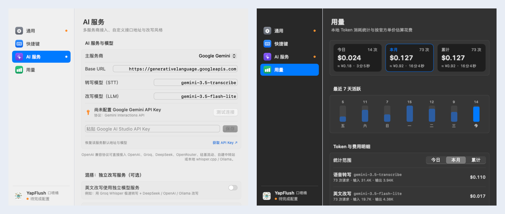

<p align="center">
  
</p>

<h1 align="center">YapFlush（口喷桶）</h1>

<p align="center">
  <strong>按住快捷键把一肚子想法倒进像素马桶，松手冲出干净体面的文字。</strong><br/>
  一款轻巧、隐私优先、支持多 AI 服务商自由接入的 macOS 菜单栏语音输入工具。
</p>

<p align="center">
  <a href="README.md">English</a> ·
  <a href="#核心特性">核心特性</a> ·
  <a href="#支持接入的-ai-服务">支持接入的 AI 服务</a> ·
  <a href="#从源码构建">从源码构建</a>
</p>

<p align="center">
  
</p>

---

## 这是什么？

发 X、写消息或敲 Prompt 时，脑子转得快但打字慢。**YapFlush（口喷桶）** 常驻在 macOS 菜单栏：

1. **按住快捷键**（默认 **左 Option** 输出地道英文，**左 Control** 输出直出中文，均可自定义）。
2. **随口开说**：屏幕右下角弹出复古像素马桶，伴随你的声音，像素符号沿抛物线飞进水口、溅起水花与阻尼弹跳。
3. **松开结束**：马桶合盖完成转写与改写，自动无痕粘贴回原输入框，不污染剪贴板历史。

---

## 核心特性

- **像素风实时语音动效**：边缘色彩反混合（De-halo）精准抠图，深浅桌面均无杂边；二次贝塞尔抛物线、前缘唇线遮挡入水、阻尼弹簧挤压回弹与极简实时音量胶囊。
- **多服务商自由接入（自带 Key）**：
  - 内置 **Google Gemini**、**OpenAI**、**Groq** 与 **自定义 OpenAI 兼容接口**（DeepSeek、OpenRouter、硅基流动、自建反代/中转，甚至本地 `whisper.cpp` / `mlx-whisper` / `Ollama`）。
  - **支持混搭**：可开启「英文改写使用独立模型服务」，例如用 **Groq Whisper** 极速转写 + **DeepSeek / OpenAI / Ollama** 改写。
- **苹果原生风格设置 & 本地用量估算**：
  - macOS 系统设置同款双栏界面（完整适配浅色与深色模式）。
  - 基于真实返回 Token 统计**今日 / 本月 / 累计**用量与预估费用 + 最近 7 天柱状图；本地仅存纯数字，绝不落盘任何音频或文本。
- **扎实好用的语音输入细节**：
  - 本地静音检测 + 首尾静音裁剪，避免误触浪费请求并减少上传体积。
  - 无痕临时粘贴（写入 `org.nspasteboard.TransientType` 标记并自动还原原剪贴板），不污染 Raycast / Paste / Maccy 剪贴板历史。
  - 503/超时自动重试一次；若仍失败则内存中保留失败录音，菜单一键「重试上次失败录音」，并保留最近 5 条内存记录。
  - 所有 API Key 仅存放在 **macOS 钥匙串（Keychain）**。

<p align="center">
  
</p>

## 让英文听起来像你

1. **先试原版。** 把[默认英文改写提示词](YapFlush/Resources/XEnglish.txt)发给 Gemini 或你常用的写作 Agent，告诉它这是待评审的提示词。然后用 YapFlush 的默认英文模式说几句你平时真会说的话，记下中文原话和实际生成的英文。
2. **先评分，再改。** 把这些中英对照发给 Agent，再给它两三条你自己写过、愿意发出去的英文当参照。请它逐条给「忠于原意」「英文自然」「像我本人」各打 1–5 分，圈出影响评分的具体措辞。告诉它哪些判断你认同，以及你自己会怎么说。
3. **把偏好写成规则和示例。** 请 Agent 根据你确认的反馈修改原版提示词，附上几组简短的「中文原话 → 你认可的英文」作为 few-shot 示例。每组体现一个不同的选择，比如保留一句冷幽默、把客套话缩短，或准确保留技术术语。优先选一组就能说明一种偏好的例子。
4. **用新句子复试。** 把整份提示词粘到 **设置 → AI 服务 → X English 系统 Prompt**，修改会自动保存。挑两句从未放进示例的中文试一下，看看输出是不是你真的会发的英文。

可以把这段话连同样本发给 Agent：

> 我会依次发给你 YapFlush 的原版提示词、几组中文原话和默认英文输出，以及我自己写的英文。先给每组输出按忠实度、自然度、个人风格分别打 1–5 分，每项用原句里的词说明理由。等我确认哪些表达像我，再修改提示词。最后给我一份可直接粘贴的英文系统提示词，包含精简的风格规则和不重复的中英示例，并保留「只输出最终英文」的要求。

---

## 支持接入的 AI 服务

底层在 [`AIClient.swift`](YapFlush/AIClient.swift) 中抽象为 `SpeechTranscriber` 与 `TextRewriter` 两套协议，实现 **Gemini Interactions** 与 **OpenAI 兼容协议**（`/audio/transcriptions` + `/chat/completions`）：

| 预设服务商 | 协议类型 | 默认转写模型（STT） | 默认改写模型（LLM） | 说明 |
| :--- | :--- | :--- | :--- | :--- |
| **Google Gemini** | Gemini Interactions | `gemini-3.5-transcribe` | `gemini-3.5-flash-lite` | 支持自定义反代 / 中转 Base URL |
| **OpenAI** | OpenAI 兼容 | `gpt-4o-mini-transcribe` | `gpt-4o-mini` | 标准 OpenAI 接口 |
| **Groq（高速 Whisper）** | OpenAI 兼容 | `whisper-large-v3-turbo` | `llama-3.3-70b-versatile` | Whisper 极速转写 |
| **自定义 OpenAI 兼容** | OpenAI 兼容 | 可自由填写 | 可自由填写 | 适配 DeepSeek、硅基流动、OpenRouter、中转站及本地 `localhost` 服务（本地服务可免 API Key） |

---

## 环境要求

- macOS 14.0（Sonoma）及以上（支持 Apple Silicon 与 Intel 通用构建）
- Xcode 15+（Swift 6.0）
- 首次运行需在「设置 → 通用」授权 **麦克风** 与 **辅助功能**

## 从源码构建

```bash
git clone https://github.com/ffaithlu-afk/YapFlush.git
cd YapFlush

xcodebuild -project YapFlush.xcodeproj \
  -scheme YapFlush \
  -configuration Release \
  -derivedDataPath build \
  build
```

编译完成后，产物位于 `build/Build/Products/Release/YapFlush.app`，拖入「应用程序」文件夹即可使用。

> **关于签名**：开源工程默认采用 ad-hoc 签名（`CODE_SIGN_IDENTITY = "-"`），拉下代码即可直接编译。如果你本地高频迭代并希望保留 macOS 权限免重复授权，可在命令中传入本机 Apple Development 证书：`CODE_SIGN_IDENTITY="Apple Development: ..."`。

## 隐私说明

- 录音仅在内存中处理，从不写入本地磁盘。
- API Key 仅保存在本机 macOS 钥匙串（`com.yapflush.api`）。
- 用量统计仅保存按天聚合的纯数字指标（次数、时长、Token 与估算费用）。

## 开源协议

[MIT](LICENSE)
